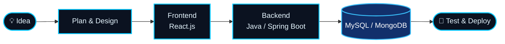

<div align="center">


<br/>


<br/><br/>

<a href="https://www.linkedin.com/in/YOUR_LINKEDIN_USERNAME/"></a>
<a href="mailto:YOUR_EMAIL@example.com"></a>
<a href="https://github.com/YOUR_GITHUB_USERNAME"></a>


</div>


<div align="center">

</div>

<table>
<tr>
<td width="58%" valign="top">

### Hello, I'm Vaishnavi Patil 👋

I am a Computer Science and Engineering graduate (2026), based in Pune, Maharashtra, India, with a strong interest in **Java Full Stack Development**.

I enjoy building web applications, developing backend functionality, working with databases, and creating responsive user interfaces. I have completed Java Full Stack training at **QSpiders, Wakad, Pune**, and gained internship experience at **Wordlane Tech**.

- 💻 Programming with **Java, Python, JavaScript and SQL**
- 🌐 Frontend development with **HTML, CSS and React.js**
- ⚙️ Backend development with **Core Java, Spring Boot and REST APIs**
- 🗄️ Database work with **MySQL and MongoDB**
- 🔧 Development tools: **Git, GitHub, VS Code and Postman**
- 🚀 Interested in building practical, user-focused software solutions

</td>
<td width="42%" valign="top">

```bash
$ whoami
vaishnavi-patil

$ cat profile.yml
name:       Vaishnavi Patil
role:       Java Full Stack Developer
location:   Pune, Maharashtra, India
education:  B.Tech - CSE (2026)
training:   Java Full Stack - QSpiders
internship: Wordlane Tech

core:
  - Java
  - JavaScript
  - React.js
  - Spring Boot
  - MySQL
  - MongoDB

$ echo $STATUS
always_learning_and_building
```

</td>
</tr>
</table>

> [!TIP]
> I am interested in software development opportunities where I can contribute to real-world projects, strengthen my development skills, and continue learning.


<div align="center">

</div>

<div align="center">



</div>


<div align="center">

</div>

<div align="center">


<br/><br/>

| | Domain | Technologies |
|:---:|:---|:---|
| 💻 | **Programming Languages** | Java, Python, JavaScript, SQL |
| 🎨 | **Frontend Development** | HTML5, CSS3, JavaScript, React.js, Responsive UI |
| ⚙️ | **Backend Development** | Core Java, Spring Boot, REST APIs, JDBC, Hibernate |
| 🗄️ | **Databases** | MySQL, MongoDB, Database Design, SQL Queries |
| 🛠️ | **Tools & Platforms** | Git, GitHub, VS Code, Postman, Jupyter Notebook |
| 📚 | **Core Concepts** | OOP, DBMS, CRUD Operations, API Integration |

</div>


<div align="center">

</div>

<table>
<tr>
<td width="50%" valign="top">

### 📚 Smart Publication Management System

A web-based publication management application developed during internship work.

**Technology stack**
- React.js frontend
- Node.js and Express.js backend
- MongoDB and MySQL
- Razorpay payment integration

</td>
<td width="50%" valign="top">

### 🚗 Automatic Accident Detection

An AI/ML project focused on accident detection, accident-area segmentation, and duration prediction.

**Project areas**
- Machine Learning
- Object detection and image analysis
- YOLO / Faster R-CNN methods
- LSTM / Transformer-based prediction approaches

</td>
</tr>
<tr>
<td width="50%" valign="top">

### 🛰️ OptiDrive System

A solution based on an ISRO problem statement, exploring autonomous navigation using mobile phone sensors.

**Project focus**
- Mobile sensor data
- Autonomous navigation
- Sensor-based positioning and movement analysis

</td>
<td width="50%" valign="top">

### 🤟 Sign Language Detection System

A computer-vision project that detects sign-language gestures.

**Technology stack**
- Python
- OpenCV
- MediaPipe
- Machine Learning

</td>
</tr>
<tr>
<td width="50%" valign="top">

### 👤 Face Recognition Attendance System

A project exploring face recognition for identifying users and recording attendance.

**Technology stack**
- Python
- OpenCV
- Face recognition

</td>
<td width="50%" valign="top">

### 🌐 More Projects

I also work on web development and database-oriented applications as part of my learning and development journey.

<a href="https://github.com/YOUR_GITHUB_USERNAME?tab=repositories">

</a>

</td>
</tr>
</table>


<div align="center">

</div>

<div align="center">

<a href="https://github.com/ryo-ma/github-profile-trophy">

</a>

</div>


<div align="center">

</div>

<div align="center">

<a href="https://github.com/YOUR_GITHUB_USERNAME">

</a>
<a href="https://github.com/YOUR_GITHUB_USERNAME">

</a>

<br/><br/>


</div>


<div align="center">

</div>

<div align="center">


</div>


<div align="center">

</div>

<div align="center">

<picture>
  <source media="(prefers-color-scheme: dark)" srcset="https://raw.githubusercontent.com/YOUR_GITHUB_USERNAME/YOUR_GITHUB_USERNAME/output/github-contribution-grid-snake-dark.svg"/>
  <source media="(prefers-color-scheme: light)" srcset="https://raw.githubusercontent.com/YOUR_GITHUB_USERNAME/YOUR_GITHUB_USERNAME/output/github-contribution-grid-snake.svg"/>
  
</picture>

</div>


<div align="center">

</div>

<div align="center">


</div>


<div align="center">

</div>

<div align="center">

**Interested in software development, Java, and building useful web applications? Let's connect!**

<br/>

<a href="https://www.linkedin.com/in/YOUR_LINKEDIN_USERNAME/"></a>
<a href="mailto:YOUR_EMAIL@example.com"></a>
<a href="https://github.com/YOUR_GITHUB_USERNAME"></a>

<br/><br/>


</div>
